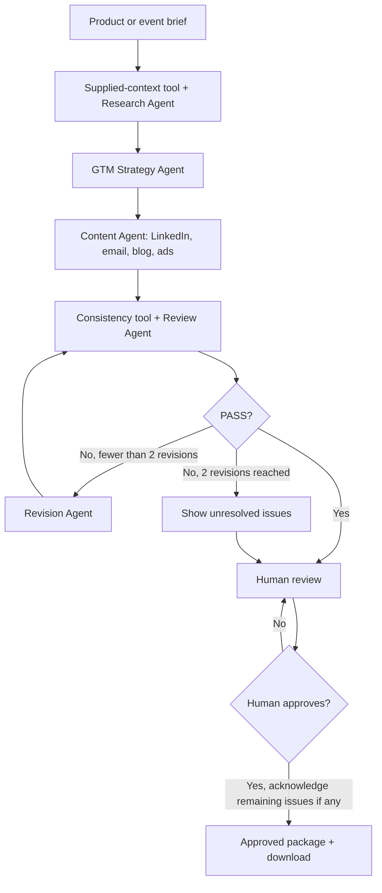

# AI GTM Content Agent

Your Week 3 Gen Academy project: a small local web app that turns a product, feature or event brief into a LinkedIn post, promotional email, short blog and three ads. It uses the installed **Ollama `qwen2.5:3b`** model. No API key, accounts, database or deployment is required.

## Start the app on this computer

The Python environment has already been installed in `.venv`. Open Terminal and paste:

```bash
cd /Users/neil/Desktop/week3-gtm-agent
.venv/bin/python -m streamlit run app.py --server.address 127.0.0.1 --server.port 8502 --browser.gatherUsageStats false
```

Open **[http://localhost:8502](http://localhost:8502)**. Keep Terminal open during your demo. Press Control+C there to stop the app. Port 8502 is used because your Week 2 app occupies 8501.

Ollama must also be running. Open the Ollama desktop app, or run `ollama serve` in a second Terminal window. If it says the address is already in use, the service is already running. The sidebar confirms the connection and lists installed models. Use `qwen2.5:3b` for the demo; `qwen2.5:1.5b` is another installed option.

## Use it

1. Keep the prefilled **AI Film Studio** example, or enter your own product information.
2. Click **Generate GTM Campaign**. Leave the page open while the local model works. Allow a few minutes, especially on the first run.
3. Watch the workflow stages, expand the strategy and read the review history.
4. Read all four content tabs. If the reviewer finds issues, the app revises and re-reviews automatically, at most twice.
5. Click **Approve Final Campaign** after reviewing the copy. If issues remain after two revisions, you must explicitly acknowledge them first.
6. See **Campaign Approved**, then download the approved Markdown package or copy the text.

Approval only approves content. The app has no posting or email-sending integration. The package cannot be downloaded before approval. Starting a new campaign resets approval.

## What makes this an agent?

An AI agent works through steps toward a goal, uses tools and state, makes decisions, and hands off when a human is needed. This app does that with plain Python functions and separate model calls, rather than one large prompt.

There are **six named stages**: research/context, strategy, content, review, conditional revision, and human approval. A successful first draft uses four distinct AI-role calls. A revision adds a Revision Agent call and another Review Agent call. When needed, a focused Blog Revision Agent repairs a short or padded blog within that same revision cycle. The controller decides whether to revise or hand off based on the review result.



## Architecture and tools

- `app.py`: Streamlit interface, progress, session state and approval controls.
- `workflow.py`: separate prompts, Ollama HTTP client, context tool, consistency tool and review/revision controller.
- `evaluate.py`: reproducible controlled tests and optional real-model evaluation.

The context tool reads your supplied brief and identifies missing information. **There is no web search**: the app explicitly labels that choice and does not claim independent research. A small supplied-date tool inserts your exact launch timing into a main format if the model omits it. It never invents a date. The consistency tool checks invented URLs, numeric claims, unfilled placeholders and some risky phrases. The separate AI reviewer checks broader factual consistency, audience, tone, clarity and contradictions. These checks do not replace human judgment.

Ollama runs the model locally via `/api/chat`. Each role returns structured JSON, which the app validates before the next step. Streamlit session state keeps the original input, context, strategy, original draft, revisions, reviews, logs and approved content. State is temporary: refreshing, closing the session or restarting can lose it. Download after approval if you need a copy.

## Install on a fresh machine

Requires Python 3.9+ and [Ollama](https://ollama.com). The current project was installed with Python 3.9.6.

```bash
cd /Users/neil/Desktop/week3-gtm-agent
python3 -m venv .venv
.venv/bin/python -m pip install -r requirements.txt
ollama pull qwen2.5:3b
```

Start Ollama and use the start command above. On another computer, replace the `cd` path with wherever you saved this folder. This project uses the macOS/Linux virtual environment path; Windows uses `.venv\Scripts\python.exe` instead.

The optional `.env.example` shows model, service address and timeout settings. You can copy it to `.env` to change them. There is no OpenAI fallback because local Ollama is available and keeps setup simpler.

## Error handling and troubleshooting

- **Ollama disconnected:** open Ollama or run `ollama serve`; click **Try Again** in the sidebar.
- **Model missing:** run `ollama pull qwen2.5:3b` and reconnect.
- **Blank name/description:** enter the missing information. Audience and launch timing may be left unknown.
- **Failed model call or invalid output:** the failing step retries once. If that fails, the workflow stops with a readable error while preserving completed intermediate state. **Try Again** restarts from the saved original brief.
- **Slow first request:** the model may need to load. The default per-request timeout is 180 seconds; change `OLLAMA_TIMEOUT` in `.env` if needed.
- **Port already in use:** visit the existing Week 3 app at localhost:8502, or stop its Terminal process before starting another.
- **Remaining review issues:** inspect the critique. Improve the input and generate again, or explicitly accept the issues before approving.

## Evaluation and submission documents

```bash
.venv/bin/python evaluate.py
.venv/bin/python evaluate.py --live
```

The first command tests workflow control and UI with controlled model responses. The second also runs real Qwen campaigns; it takes longer and requires Ollama. Both write `evaluation_report.md`; live runs save actual model outputs in `evaluation_outputs.json`. Read the report for the actual results and their limits. Rerunning without `--live` replaces the report with only the controlled tests.

- `PROJECT_DOCUMENTATION.md`: assignment explanation and implementation details.
- `DEMO_SCRIPT.md`: a beginner-friendly 3–4 minute presentation.
- `evaluation_questions.md`: scenarios and expected behavior.
- `evaluation_report.md`: recorded outcomes, clearly labeled by testing mode.

API details follow [Ollama's structured-output documentation](https://docs.ollama.com/capabilities/structured-outputs). UI testing uses [Streamlit AppTest](https://docs.streamlit.io/develop/api-reference/app-testing/st.testing.v1.apptest).
